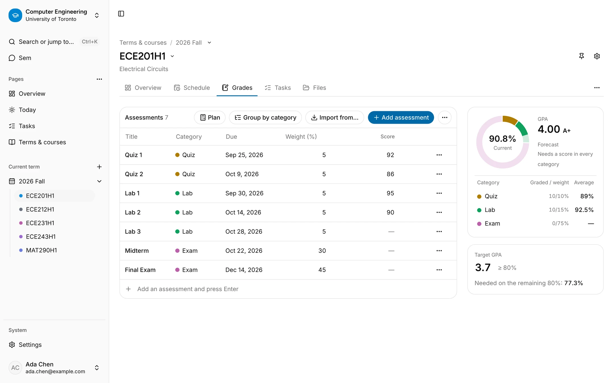
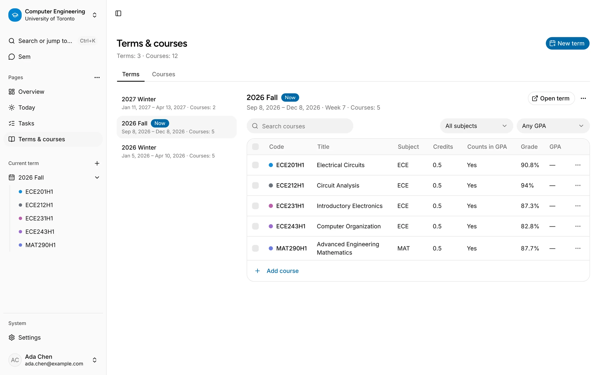
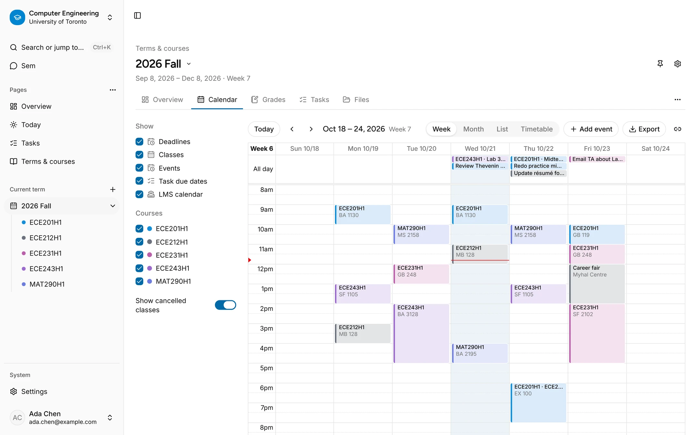
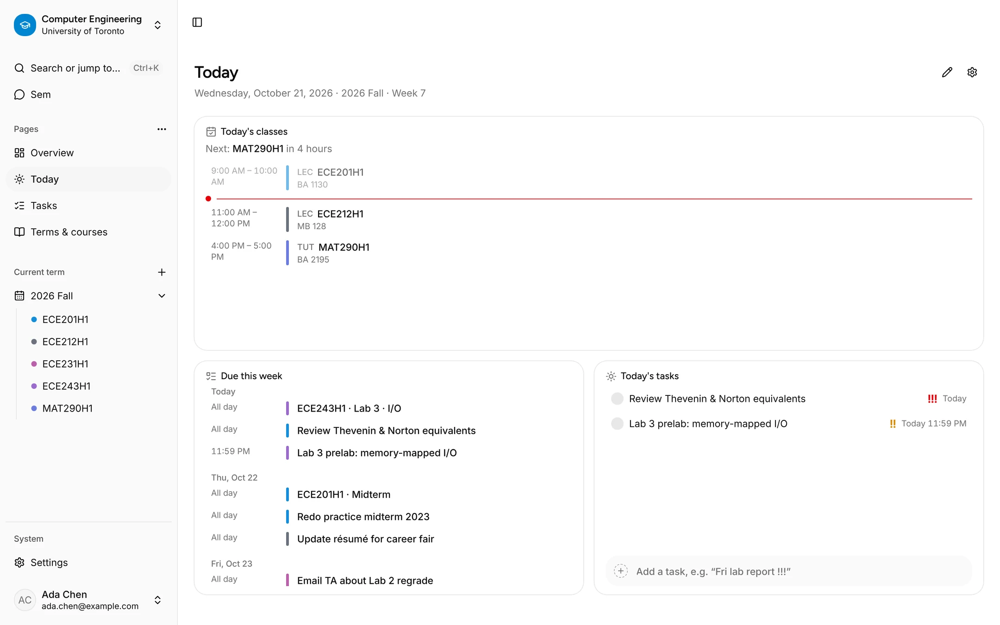
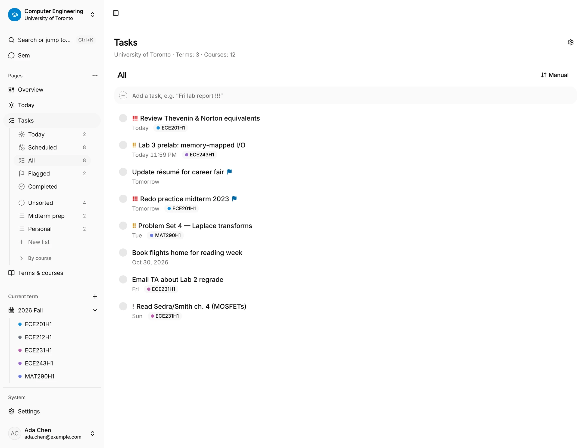
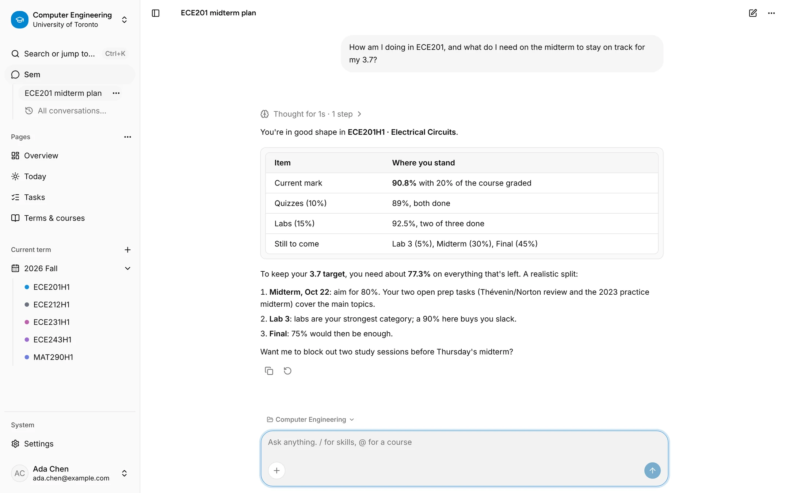
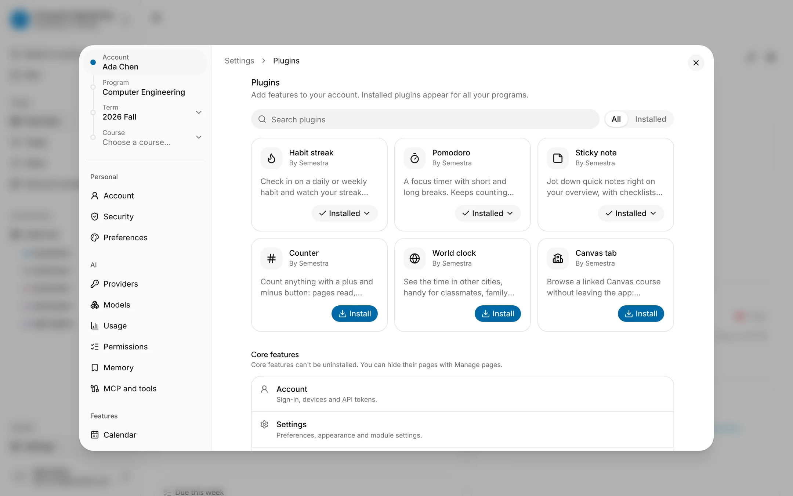

<div align="center">

# Semestra

**Your whole degree in one place: courses, grades, schedule, tasks, and an AI assistant that knows all of it.**

[简体中文](README.zh-CN.md) · [Quick start](#quick-start) · [Self-hosting](deploy/selfhost/README.md) · [Docs](docs/specs/README.md)


<br />

<picture>
  <source media="(prefers-color-scheme: dark)" srcset="docs/assets/screenshots/grades-dark.webp" />
  
</picture>

</div>

## What is Semestra?

Semestra is a semester planner for university students. Set up your program once, add terms and courses, and Semestra keeps the rest connected: the gradebook works out your current mark and what you need on the final, the calendar knows your lectures, labs and exams, deadlines turn into tasks, and **Sem**, the built-in assistant, can read and update all of it in plain language.

This repository is a ground-up rewrite of the original [Semestra](https://github.com/jinyuanZhou-Leo/Semestra). Every feature is a module that declares typed capabilities, so the same operation is available in the UI, to the assistant, to plugins and over MCP.

## Features

### Grades and GPA

<picture>
  <source media="(prefers-color-scheme: dark)" srcset="docs/assets/screenshots/academics-dark.webp" />
  
</picture>

- **A gradebook for every course** with weighted categories, dropped assessments, scores as points or percentages, and a live current mark.
- **Forecasts and plan mode.** Set a target and see the average you need on what's left, or try "what if" scores without touching your real marks.
- **Term and cumulative GPA** with built-in scales (UofT 4.0 by default, plus US 4.33, standard 4.0, Australian 7 and Korean 4.5) or your own conversion table.
- **Full-year courses** that span several terms and still carry one final grade.

### Schedule and calendar

<picture>
  <source media="(prefers-color-scheme: dark)" srcset="docs/assets/screenshots/schedule-dark.webp" />
  
</picture>

- **Weekly class meetings by section** (lecture, tutorial, practical) with rooms, week ranges and one-off cancellations.
- **One calendar for everything:** classes, assessment deadlines, task due dates, events and your LMS calendar, in week, month, list or timetable view.
- **Conflict warnings** when two meetings overlap, plus **ICS export and subscription links** for the calendar on your phone.

### Today and tasks

<picture>
  <source media="(prefers-color-scheme: dark)" srcset="docs/assets/screenshots/today-dark.webp" />
  
</picture>

<picture>
  <source media="(prefers-color-scheme: dark)" srcset="docs/assets/screenshots/tasks-dark.webp" />
  
</picture>

- **A Today page** with your next class, what's due this week and today's tasks.
- **Tasks with lists, smart lists and quick add.** Type `Fri lab report !!!` and the date and priority fill themselves in. Tasks can belong to a course, and assessments can create matching tasks when you turn that on.
- **Pages you arrange yourself.** Every program, term and course page is a board of cards you can reorder, resize and extend with plugins.

### Sem, the AI assistant

<picture>
  <source media="(prefers-color-scheme: dark)" srcset="docs/assets/screenshots/assistant-dark.webp" />
  
</picture>

- **Ask about anything in your account**, like "what do I need on the midterm?" or "move my ECE243 lab to Friday". Sem uses the same capabilities as the app and by default shows a confirmation card before it changes your data.
- **Bring your own key** for Anthropic, OpenAI, Google Gemini, Ollama, or any OpenAI- or Anthropic-compatible endpoint. Usage and cost are tracked per model.
- **Smart import.** Drop in a syllabus, a timetable or an ICS file, then review the extracted courses, meetings and assessments before anything is saved.
- **Memory, skills and temporary chats**, and an **MCP server** at `/mcp` so external clients can use the same tools with an API token.

### Plugins and integrations

<picture>
  <source media="(prefers-color-scheme: dark)" srcset="docs/assets/screenshots/plugins-dark.webp" />
  
</picture>

- **Canvas LMS:** link a Canvas course to import its assignments, overlay its calendar, and browse announcements, grades, modules, pages and quizzes in a Canvas tab.
- **First-party plugins**, installed per account: habit streak, Pomodoro timer, sticky notes, counter and world clock. See the [plugin authoring guide](apps/docs/content/docs/plugins.mdx).
- **Settings that inherit** from account to program, term and course; light and dark themes; full English and Simplified Chinese.
- **Your data stays yours:** export everything to one archive, import it into another instance, or delete your account.

## Tech stack

| Layer | Choice |
|---|---|
| Backend | FastAPI, SQLAlchemy 2, Alembic, SQLite (with FTS5 and sqlite-vec), Python 3.15 via uv |
| AI | Pydantic AI agent loop on the official provider SDKs, through an SSRF-safe HTTP client |
| Frontend | React 19, TypeScript 7, Vite 8, TanStack Router (SPA), TanStack Query, Table and Form, React Compiler |
| UI | shadcn/ui on Base UI, Tailwind CSS 4, AI Elements, FullCalendar |
| i18n | Paraglide JS (`en`, `zh-CN`) |
| API client | Generated from the OpenAPI schema with `@hey-api/openapi-ts` |
| Tooling | pnpm workspaces, oxlint and oxfmt, ruff, pyright, Vitest, pytest, Playwright |
| Deployment | Docker (self-host compose) |

## Quick start

You need [uv](https://docs.astral.sh/uv/) 0.13+, Node 26+ and pnpm 12+.

```bash
git clone https://github.com/jinyuanZhou-Leo/Semestra-Next.git
cd Semestra-Next

uv python install 3.15
pnpm install
uv sync --project apps/api
pnpm --filter @semestra/api migrate

pnpm dev        # API on http://localhost:8000, web on http://localhost:5173
```

Open <http://localhost:5173> and sign in with any email address. In development no email is sent: the verification code is printed in the API log and written to `apps/api/data/dev-outbox.jsonl`.

To chat with Sem, open **Settings → AI → Providers** and add an API key, or point it at a local Ollama. Outbound requests to localhost and private addresses are blocked by default, so for a local Ollama add `SEMESTRA_ALLOW_PRIVATE_EGRESS=true` to `apps/api/.env` and restart `pnpm dev`.

### Common commands

| Command | What it does |
|---|---|
| `pnpm dev` | Run the API (with auto-reload) and the web app together |
| `pnpm lint` / `pnpm format` | oxlint, oxfmt, i18n and React Compiler checks for the web app; ruff for the API |
| `pnpm typecheck` | `tsc` and pyright |
| `pnpm test` | Vitest and pytest |
| `pnpm gen:api` | Export the OpenAPI schema and regenerate `packages/api-client` |
| `pnpm --filter @semestra/web e2e` | Playwright smoke tests (run `pnpm --filter @semestra/web exec playwright install chromium` once first) |

## Self-hosting

A single container serves both the API and the web app:

```bash
cd Semestra-Next/deploy/selfhost
cp .env.example .env    # optional
docker compose up -d    # then open http://localhost:8000
```

The image isn't public yet: see [deploy/selfhost/README.md](deploy/selfhost/README.md) to log in to `ghcr.io` or build it locally.

Email, secrets, backups and upgrades are covered in [deploy/selfhost/README.md](deploy/selfhost/README.md), and every environment variable is documented in [deploy/.env.example](deploy/.env.example).

## Project structure

```
apps/
  api/                 FastAPI backend: src/semestra/{core, modules/*}
  web/                 React SPA: src/{routes, app, modules/*, ui, components, lib}
  docs/                Documentation site (Fumadocs, static): self-hosting, AI, MCP, LMS, API
packages/
  api-client/          TypeScript client generated from OpenAPI (don't edit src/generated)
deploy/                Dockerfile, self-host compose, release and deploy scripts
docs/
  specs/               One design spec per module, M00 to M16
```

Most features are a module on both sides: `academics`, `grading`, `schedule`, `tasks`, `files`, `imports`, `lms`, `ai`, `plugins`, `settings`, `portability` and more (the assistant is `agent` in the API and `assistant` in the web app). A backend module declares **capabilities**, and by default each one becomes a REST route, an assistant tool and an MCP tool from a single definition. A frontend module registers its pages, cards and settings with `defineModule`.

## Roadmap

- **Single-user mode for self-hosting** (planned): with `SEMESTRA_SINGLE_USER=true`, the first visitor creates an admin account with email and password, then sign-up closes. The variable is reserved in `deploy/.env.example` but does nothing yet.

## Documentation

- [Module specs](docs/specs/README.md): the design of every module, with implementation notes
- [CLAUDE.md](CLAUDE.md): development conventions and known pitfalls
- [Documentation site](apps/docs) (locally `pnpm docs:dev`, then open `http://localhost:3001/docs`): self-hosting, AI providers, MCP, Canvas, the API reference and [plugin authoring](apps/docs/content/docs/plugins.mdx)
- [Deployment](deploy/README.md)

Most design documents are written in Chinese.
