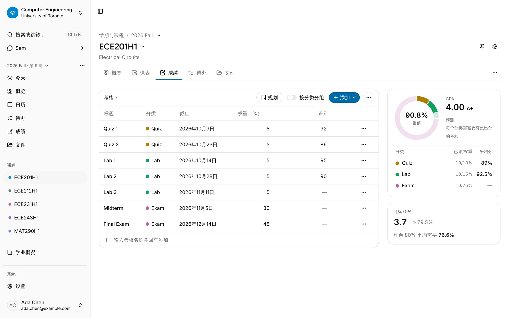
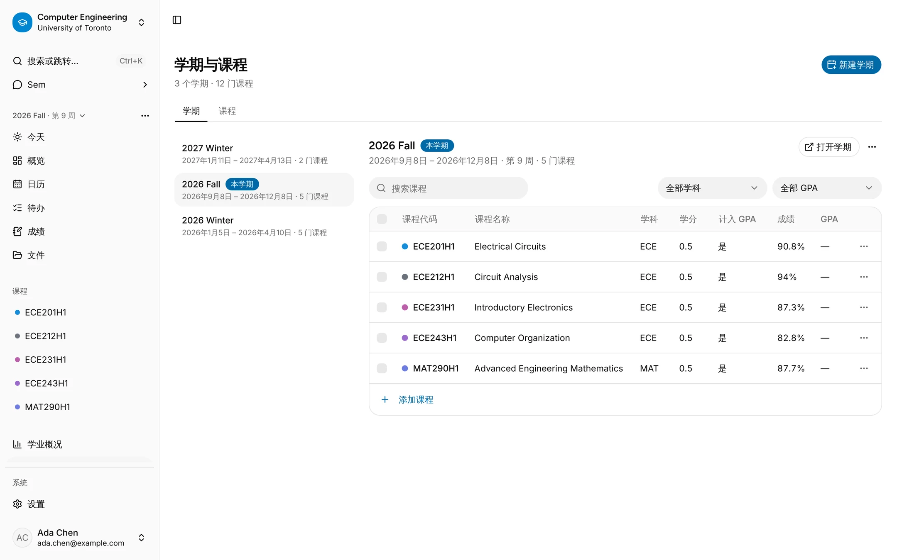
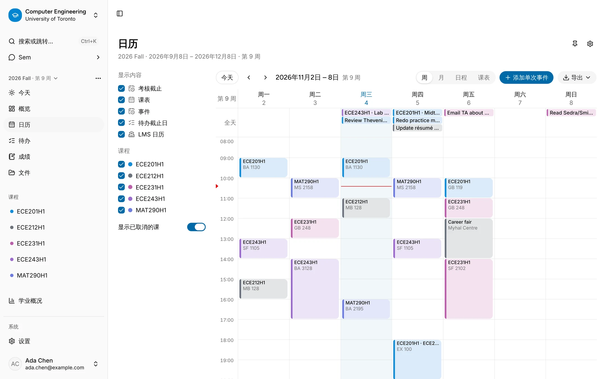
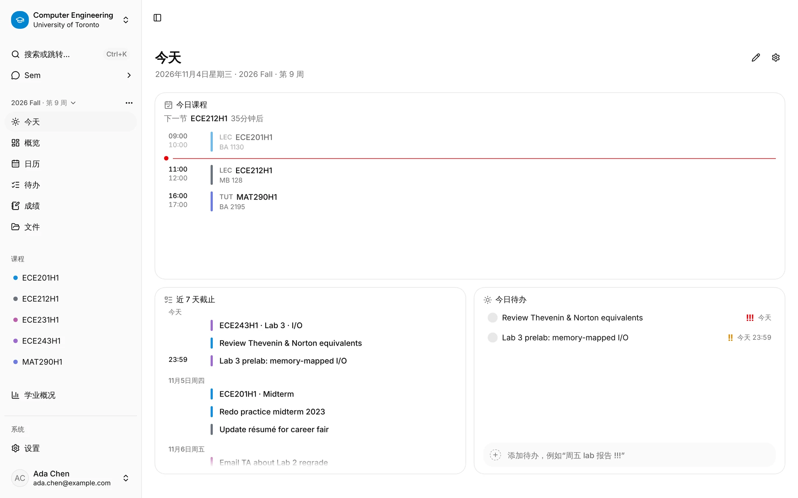
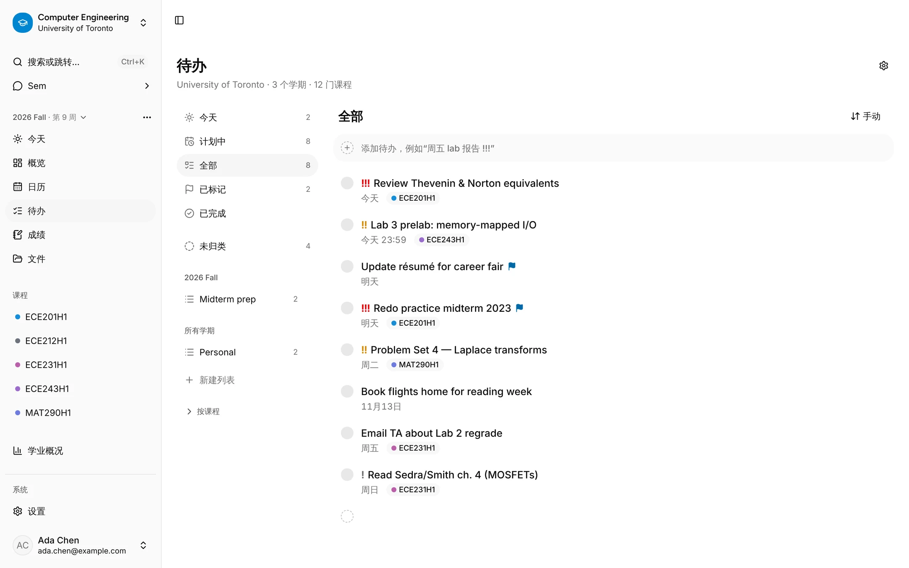
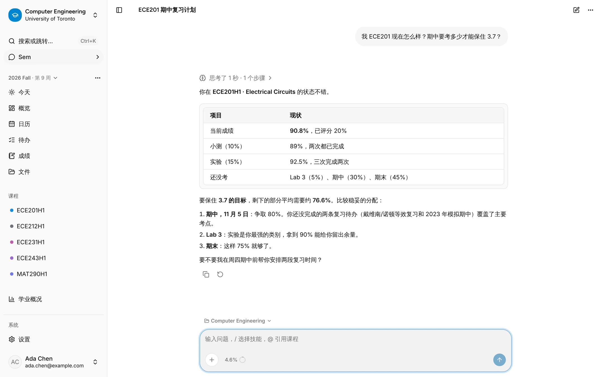
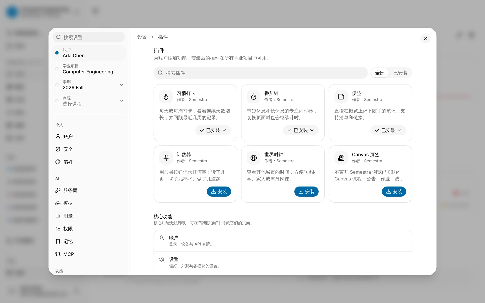

<div align="center">

# Semestra

**把整个学业放在一处：课程、成绩、课表、待办，还有一个什么都知道的 AI 助手。**

[English](README.md) · [快速开始](#快速开始) · [自部署](deploy/selfhost/README.md) · [文档](docs/specs/README.md)


<br />

<picture>
  <source media="(prefers-color-scheme: dark)" srcset="docs/assets/screenshots/grades-zh-dark.webp" />
  
</picture>

</div>

## Semestra 是什么？

Semestra 是给大学生用的学期规划工具。建好学业项目，加上学期和课程，其余的都会自动连起来：成绩簿算出当前成绩和期末需要考多少，日历知道你的讲座、实验和考试，截止日期变成待办，内置助手 **Sem** 可以用自然语言查看和修改这一切。

这个仓库是 [Semestra](https://github.com/jinyuanZhou-Leo/Semestra) 的从零重写版。每个功能都是一个声明了类型化 capability 的模块，所以同一个操作在界面里、在助手里、在插件里、通过 MCP 都能用。

## 功能

### 成绩与 GPA

<picture>
  <source media="(prefers-color-scheme: dark)" srcset="docs/assets/screenshots/academics-zh-dark.webp" />
  
</picture>

- **每门课一个成绩簿**：加权分类、可标记不计入的考核、按分数或百分比录入，当前成绩实时计算。
- **预测与规划模式**：设定目标，看剩下的考核平均需要多少分；或者试填"假设"分数，不影响真实成绩。
- **学期与累计 GPA**：内置换算表（默认多伦多大学 4.0，另有美国 4.33、标准 4.0、澳洲 7 分制、韩国 4.5），也可以自定义。
- **全年课**：跨多个学期，但只有一个最终成绩。
- **学业概况**：整个学业项目的累计 GPA，以及按学期的 GPA 与学分图表。

### 课表与日历

<picture>
  <source media="(prefers-color-scheme: dark)" srcset="docs/assets/screenshots/schedule-zh-dark.webp" />
  
</picture>

- **按教学班管理上课时间**（讲座、辅导、实验），带教室、起止周和单次停课。
- **一个日历看全部**：上课、考核截止、待办到期、事件和 LMS 日历，支持周、月、列表和课表视图。
- **冲突提醒**：上课时间重叠时会提示。
- **导出与订阅**：日历可以存为图片、PDF 或 `.ics` 文件；每个学业项目还有一个订阅链接，可以添加到 Google 日历或手机日历，随时重置或停用。

### 今天与待办

<picture>
  <source media="(prefers-color-scheme: dark)" srcset="docs/assets/screenshots/today-zh-dark.webp" />
  
</picture>

<picture>
  <source media="(prefers-color-scheme: dark)" srcset="docs/assets/screenshots/tasks-zh-dark.webp" />
  
</picture>

- **今天页**：下一节课、未来 7 天到期的内容和今天的待办。打开应用时先进入哪个页面，可以在 **设置 → 偏好设置** 里选。
- **待办支持列表、智能列表和快速添加**：输入 `Fri lab report !!!`，日期和优先级会自动识别。待办可以归属课程，考核也能自动生成待办（在设置里开启）。
- **页面自己排**：学业项目、学期和课程的页面都是卡片看板，可以排序、调整大小，还能用插件扩展。
- **手机上也能用**：在手机上打开是精简版，包含今天、待办和 Sem，可以添加到主屏幕。

### 课程文件

- **给每门课上传课件、笔记和阅读材料**，在应用里预览 PDF，并按关键词搜索文件内容（配置了 embedding 模型后还能按语义搜索）。
- **扫描页用 OCR 识别**：使用你的 AI 服务商，自部署时也可以用本机的 OCR 模型。
- **Sem 会注明出处**：引用文件的回答会链接到对应页码。

### Sem：AI 助手

<picture>
  <source media="(prefers-color-scheme: dark)" srcset="docs/assets/screenshots/assistant-zh-dark.webp" />
  
</picture>

- **问账户里的任何事**，比如"期中要考多少分？"、"把 ECE243 的实验挪到周五"。Sem 用的是和应用相同的 capability，默认在修改数据前先给出确认卡片。
- **使用你自己的 API 密钥**：支持 Anthropic、OpenAI、Google Gemini、Ollama，以及任何兼容 OpenAI 或 Anthropic 接口的服务商，按模型统计用量和费用。
- **智能导入**：拖入课程大纲、课表或 ICS 文件，先审核抽取出的课程、上课时间和考核，再保存。
- **记忆、技能和临时对话**：长对话会自动压缩，上下文圆环显示剩余空间。
- **按功能设置权限**，决定 Sem 哪些操作可以直接执行、哪些要先确认；MCP 客户端只有在你允许后才能删除数据。`/mcp` 上的 **MCP 服务端**让外部客户端用 API 令牌调用同样的工具。

### 插件与集成

<picture>
  <source media="(prefers-color-scheme: dark)" srcset="docs/assets/screenshots/plugins-zh-dark.webp" />
  
</picture>

- **Canvas LMS**：关联 Canvas 课程后可以导入作业、叠加它的日历，并在 Canvas 标签页里浏览公告、成绩、单元、页面和测验。
- **官方插件**，按账户安装：习惯打卡、番茄钟、便签、计数器和世界时钟。写插件见[插件开发指南](apps/docs/content/docs/plugins.zh.mdx)。
- **设置逐级继承**：账户 → 学业项目 → 学期 → 课程，所有设置都能搜索；亮色与暗色主题，可选强调色；完整的中英文界面。
- **数据归你所有**：一键导出为一个归档，导入到另一个实例，或者删除账户。

## 技术栈

| 层 | 选型 |
|---|---|
| 后端 | FastAPI、SQLAlchemy 2、Alembic、SQLite（FTS5 与 sqlite-vec），Python 3.14（uv） |
| AI | 基于官方 SDK 的 Pydantic AI agent 循环，出站请求走防 SSRF 的 HTTP 客户端 |
| 前端 | React 19、TypeScript 7、Vite 8、TanStack Router（SPA）、TanStack Query / Table、React Compiler（Oxc） |
| UI | shadcn/ui（Base UI）、Tailwind CSS 4、AI Elements、FullCalendar |
| 国际化 | Paraglide JS（`en`、`zh-CN`） |
| API 客户端 | 用 `@hey-api/openapi-ts` 从 OpenAPI 生成 |
| 工具链 | pnpm workspaces、oxlint 与 oxfmt、ruff、pyright、Vitest、pytest、Playwright |
| 部署 | Docker（自部署 compose） |

## 快速开始

需要 [uv](https://docs.astral.sh/uv/) 0.13+、Node 26+、pnpm 12+。

```bash
git clone https://github.com/jinyuanZhou-Leo/Semestra-Next.git
cd Semestra-Next

uv python install 3.14
pnpm install
uv sync --project apps/api
pnpm --filter @semestra/api migrate

pnpm dev        # API http://localhost:8000，Web http://localhost:5173
```

打开 <http://localhost:5173>，用任意邮箱登录。开发环境不会真的发邮件：验证码会打印在 API 日志里，并写入 `apps/api/data/dev-outbox.jsonl`。

要和 Sem 对话，打开 **设置 → AI → 服务商**，添加一个 API 密钥，或者指向本地的 Ollama。默认会拦截发往 localhost 和内网地址的请求，所以用本地 Ollama 时要在 `apps/api/.env` 里加上 `SEMESTRA_ALLOW_PRIVATE_EGRESS=true`，再重启 `pnpm dev`。

### 常用命令

| 命令 | 作用 |
|---|---|
| `pnpm dev` | 同时启动 API（自动重载）和 Web |
| `pnpm lint` / `pnpm format` | Web 跑 oxlint、oxfmt、文案检查和 React Compiler 检查；API 跑 ruff |
| `pnpm typecheck` | `tsc` 与 pyright |
| `pnpm test` | Vitest 与 pytest |
| `pnpm gen:api` | 导出 OpenAPI 并重新生成 `packages/api-client` |
| `pnpm --filter @semestra/web e2e` | Playwright 冒烟测试（第一次先运行 `pnpm --filter @semestra/web exec playwright install chromium`） |

## 自部署

一个容器同时提供 API 和网页：

```bash
cd Semestra-Next/deploy/selfhost
cp .env.example .env    # 可选
docker compose up -d    # 然后打开 http://localhost:8000
```

镜像已在 `ghcr.io` 公开。在局域网里运行、在有域名的服务器上运行（内置 Caddy，自动 HTTPS）、放在自己的反向代理后面，以及升级，见 [deploy/selfhost/README.md](deploy/selfhost/README.md)。邮件、备份、镜像选择、本机 OCR 等可选功能和全部设置见[自部署文档](apps/docs/content/docs/self-hosting)，全部环境变量列在 [deploy/.env.example](deploy/.env.example)。

## 目录结构

```
apps/
  api/                 FastAPI 后端：src/semestra/{core, modules/*}
  web/                 React SPA：src/{routes, app, modules/*, ui, components, lib}
  docs/                文档站（Fumadocs，静态导出）：自部署、AI、MCP、LMS、API
  site/                官网（Astro）
packages/
  api-client/          由 OpenAPI 生成的 TypeScript 客户端（不要手改 src/generated）
deploy/                Dockerfile、自部署 compose、发布与部署脚本
docs/
  specs/               每个模块一份设计规格，M00 到 M17
```

大多数功能在前后端各是一个模块：`academics`、`grading`、`schedule`、`tasks`、`files`、`imports`、`lms`、`ai`、`plugins`、`settings`、`portability` 等（助手在后端叫 `agent`，在前端叫 `assistant`）。后端模块声明 **capability**，一份定义默认同时生成 REST 路由、助手工具和 MCP 工具；前端模块通过 `defineModule` 注册自己的页面、卡片和设置。

## 路线图

- **自部署单用户模式**（规划中）：设置 `SEMESTRA_SINGLE_USER=true` 后，第一个访问者用邮箱和密码创建管理员账户，之后关闭注册。这个变量已经在 `deploy/.env.example` 里预留，但目前还不起作用。

## 文档

- [模块规格](docs/specs/README.md)：每个模块的设计与实现说明
- [CLAUDE.md](CLAUDE.md)：开发约定与已知的坑
- [文档站](apps/docs)（本地运行 `pnpm docs:dev` 后打开 `http://localhost:3001/docs`）：自部署、AI 服务商、MCP、Canvas、API 参考与[插件开发指南](apps/docs/content/docs/plugins.zh.mdx)
- [部署](deploy/README.md)
